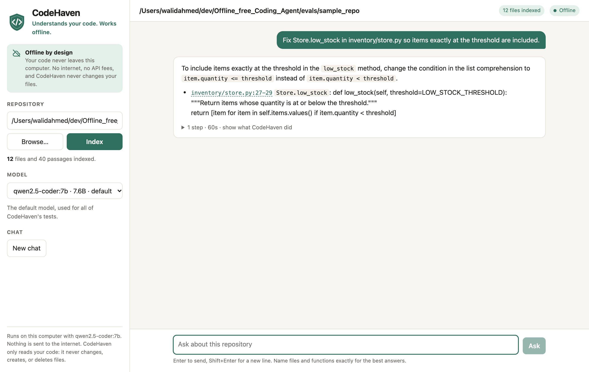

# CodeHaven

**Ask your codebase anything. Nothing leaves your machine.**

*Your code. Your machine. No API fees.*


CodeHaven is a read-only assistant for understanding code. Point it at a project, ask a question in plain English, and get an answer that cites the exact lines it relies on. One click shows you those lines. It runs on a local [Ollama](https://ollama.com/) model (`qwen2.5-coder:7b` by default), so there is no cloud service, no account, and no bill.

| | |
|---|---|
| **Private** | Your code is sent only to Ollama on `127.0.0.1`. No cloud inference, no telemetry, no tracing. |
| **Read-only** | It never changes, creates, or deletes your files. Ask for a fix and it explains what to change and where. |
| **Checked** | Line numbers are looked up in the real file, never taken from the model. An answer it cannot back up is marked **Unverified**. |
| **Free** | It runs on a model you download once. After that it works with the network unplugged. |



Watch the [narrated demo video on YouTube](https://youtu.be/d18wHCz8LFs) (or the [video file](docs/assets/codehaven-demo.mp4) in this repository), or read on.

## What you can ask

| You ask | You get |
|---|---|
| "Explain this project" | An overview with citations to the code behind each point |
| "Which function calls `checkout_total`?" | Every caller, with the function each one is in |
| "Fix `Store.low_stock` so items at the threshold are included" | The lines to change and the new code. Your file is left untouched |
| "Explain my uncommitted changes" | [Your Git diff, explained](#explain-your-git-changes) with citations to the changed lines |
| "Review `inventory/store.py`" | [Likely bugs](#review-a-file), one function at a time, most serious first |
| "Which functions have no tests?" | [A list of test gaps](#test-gaps-and-a-project-tour), instantly, with no model |
| "Give me a project tour" | An ordered reading list of up to 8 files |
| "اشرح الدالة `checkout_total`" | [The answer in Arabic](#ask-in-arabic), with the same checked citations |

In the browser page you can also draw a **structure map** of your files, make **flashcards** to study them, chat about a [notebook or PDF](#notebooks-and-pdfs), and turn a [screenshot of code](#read-code-from-a-picture) into a file. CodeHaven [remembers checked answers](#long-term-memory) and [your chats](#saved-chats) between sessions, on your computer only.

## Contents

- [Get started](#get-started)
- [How it is built](#how-it-is-built)
- [Chat in your browser](#chat-in-your-browser)
- [Use it from the terminal](#use-it-from-the-terminal)
- Features: [Git changes](#explain-your-git-changes) · [File review](#review-a-file) · [Test gaps and project tour](#test-gaps-and-a-project-tour) · [Notebooks and PDFs](#notebooks-and-pdfs) · [Pictures of code](#read-code-from-a-picture) · [Long-term memory](#long-term-memory) · [Saved chats](#saved-chats) · [Search by meaning](#search-by-meaning) · [Arabic](#ask-in-arabic)
- Reference: [Choosing a model](#choosing-a-model) · [Ollama and offline use](#ollama-and-offline-use) · [What v0.10 does](#what-v010-does) · [File exclusions](#file-exclusions) · [RAG](#local-reference-knowledge-base-rag) · [Speed](#local-inference-speed) · [Search](#search-file-contents) · [Isolated tests](#run-isolated-project-tests) · [Limits](#current-limits)
- [Development](#development)
- [Technical report](docs/TECHNICAL_REPORT.md)

## Get started

You need Python 3.10+ and [Ollama](https://ollama.com/). While you are online, do this once:

```sh
# 1. Start Ollama with cloud features off (leave this terminal open)
python3 scripts/start_ollama.py

# 2. In another terminal, download the default model
ollama pull qwen2.5-coder:7b

# 3. Install CodeHaven in a virtual environment
python3 -m venv .venv
source .venv/bin/activate        # Windows PowerShell: .venv\Scripts\Activate.ps1
python -m pip install -e .

# 4. Optional: install Tesseract, only if you want CodeHaven to read code from pictures
brew install tesseract           # Ubuntu or Debian: sudo apt install tesseract-ocr

# 5. Optional: download an embedding model, so search also works by meaning
ollama pull nomic-embed-text

# 6. Optional: a PDF reader, only if you want to chat about PDFs
python -m pip install pypdf      # or: brew install poppler
```

Step 4 is needed only for [pictures of code](#read-code-from-a-picture). Ollama runs the chat model; Tesseract is a second, separate local program that reads the text in a picture. It is not an Ollama model, so `ollama pull` does not install it. On Windows, use an installer from the [Tesseract installation page](https://tesseract-ocr.github.io/tessdoc/Installation.html) and make sure `tesseract --version` works in a new terminal.

After that, everything works offline. Each time, activate the environment and open the browser page:

```sh
source .venv/bin/activate
codehaven --gui
```

## How it is built


CodeHaven is one agent, five tools, and a set of purpose-built helpers. The [technical report](docs/TECHNICAL_REPORT.md) covers each part in depth.

### The workflow

1. **You ask**, in the browser page or the terminal.
2. **A router picks the path.** This is plain code, not a model. A request with a known shape, such as "explain my last commit", goes to a helper built for it. Every other question goes to the agent.
3. **Plain code gathers context first.** It retrieves relevant passages, preloads files the question names, and searches for the code names it mentions. A small model often skips these steps when left alone.
4. **The agent loops.** The local model picks one action per step. The tool runs, and its result goes back to the model, until the model returns `finish`.
5. **The answer is checked.** Line numbers are looked up in the real file, and every citation must match code that was actually read.
6. **You get a cited answer.** Checked answers are saved for later sessions.

### The agent

There is one agent, not several. It is a [LangGraph](https://docs.langchain.com/oss/python/langgraph/graph-api) loop around a single local model. A small model that plans, delegates, and merges results spends its steps on coordination, so CodeHaven keeps the model's job narrow: pick the next action, then explain what the evidence shows.

### The tools

| Tool | What it does |
|---|---|
| `read` | Reads a project file, in pages for long files |
| `search` | Finds exact text and names the function each match is in |
| `retrieve` | Fetches ranked passages from the local index |
| `run_tests` | Runs unittest or pytest in a Docker container with networking off, after you approve |
| `finish` | Returns the answer and the code parts it relies on |

No tool writes files. `edit` and `write` do not exist, and the model is corrected if it asks for them.

### The helpers

| Helper | Uses the model | How it works |
|---|---|---|
| Git changes | Yes | Reads the diff with read-only git commands, then explains it |
| File review | Yes | One function per model call, because a small model shown a whole file says "looks fine" |
| Project tour | Yes | The order comes from the import graph; the model adds one sentence per file |
| Flashcards | Yes | The model writes the cards; the lines each answer is about are looked up |
| Test gaps | No | Lists public functions that no test file mentions |
| Structure map | No | Draws calls and imports from parsed code |
| Picture to code | No | Tesseract reads the picture and indentation is rebuilt |

### Local knowledge

Passages reach the model four ways: keyword ranking (BM25), definition lookup for names in the question, import following across Python, JavaScript, TypeScript, Go, Java, and Rust, and optional [search by meaning](#search-by-meaning) with a local embedding model.

### The agent loop in detail


A high-resolution [PNG version](docs/assets/how-codehaven-works.png) is available for slides.

```text
START -> model -> read, search, retrieve, or run_tests -> model
             |-> invalid reply -> correction message -> model (once)
             \-> finish -> END
                    tool at action limit -> limit -> END
```

The graph holds conversation messages, the current action, the action count, and the exit code in memory. It uses conditional edges to dispatch actions. There is no node that writes files. The action limit counts model responses, not internal graph nodes. Graph recursion has a separate guard sized to that limit. This version does not add persistent checkpoints.

If the model returns invalid JSON, an unknown action (including `edit` or `write`, which do not exist), missing fields, or a reply cut off at the token limit, no tool runs. The model gets one correction message explaining what was wrong, and the retry counts as a step. A second invalid reply in a row stops the task with exit code 1. Failures to reach Ollama are never retried.

Small models at temperature 0 sometimes repeat the same sentences until they hit the token limit. Replies are always streamed from Ollama, so a final answer that keeps repeating a phrase is stopped as soon as the loop is detected. The text before the repetition is kept as the answer, marked with a note. An answer that reaches its length limit ends at its last complete sentence, also with a note.

Identical actions are caught anywhere in a task, not only back to back, so alternating lookups stop early instead of using every step. An action may be repeated after compaction has removed its earlier result.

Implementation follows the [LangGraph graph API](https://docs.langchain.com/oss/python/langgraph/graph-api). Remote tracing is not supported. Every run is wrapped in [`tracing_context(enabled=False)`](https://docs.langchain.com/langsmith/trace-without-env-vars), so `LANGSMITH_TRACING`, `LANGCHAIN_TRACING_V2`, or an API key in your environment cannot turn uploads on. No tracing client is ever created. For timing and token details, use the local `Ollama metrics:` line printed after each model call.

## Chat in your browser

`codehaven --gui` opens a page in your browser:

1. **Pick a repository.** Type its path or click **Browse…** (Git repositories are marked), then click **Index**. Indexing a typical project takes a few seconds, and the page shows how many files it indexed. Recent repositories are listed for one-click reopening.
   **Or upload a single file.** No folder needed for a quick question: click **Upload a file…** or drop a file anywhere on the page. Any UTF-8 text file up to 64 KB works, and every question is about that file, so "What does this file do?" works without naming it. The file is sent only to the local server, which reads a copy kept in a private temporary folder and deletes it when you open something else or stop the server; your original file is never touched. Hidden files such as `.env`, and names matched by `--exclude`, are refused. The paperclip button beside the question box and pasting a copied file do the same, and the conversation is kept when a file is opened this way.
   **Or download a GitHub repository (opt-in).** Start with `codehaven --gui --allow-clone` and the sidebar shows a box for an address such as `github.com/owner/repository`. This is the only time CodeHaven uses the internet, and only when you click **Download and index**: git on your computer downloads the latest snapshot (no history, tags, submodules, or Git LFS files; stopped after 3 minutes or 500 MB) into `~/CodeHaven/repos/owner/repository` (change it with `--clone-dir`). Nothing of yours is uploaded. The copy stays on your computer, so later it opens offline from **Recent**, and asking for the same address again opens it without downloading. Without `--allow-clone` the box is hidden, the server refuses to clone, and CodeHaven stays fully offline.
   **Private repositories.** CodeHaven never asks for, sees, or stores a GitHub password or token, and refuses addresses that contain one. A private repository downloads only if git on this computer is already signed in to an account that can read it: a credential helper (for example after `gh auth login`), or an SSH key with a `git@github.com:owner/repository.git` address. git is not allowed to prompt for a password or passphrase. Otherwise, clone it yourself with your usual tools and index the folder.
   **Or upload a notebook or a PDF.** The same button and drop area take a Jupyter notebook (`.ipynb`) or a PDF, up to 8 MB. See [Notebooks and PDFs](#notebooks-and-pdfs).
   **Or upload a picture of code.** The same button and drop area take a screenshot or photo of code, which CodeHaven turns into a file you can chat about and save. See [Read code from a picture](#read-code-from-a-picture).
2. **Pick a model.** **Settings** in the sidebar lists the chat models installed in Ollama on this computer, with `qwen2.5-coder:7b` selected when it is installed. That default is the model all of CodeHaven's tests were tuned and measured on; other models may answer differently, and the first answer after switching is slower while the model loads. Cloud-backed and embedding-only models are never offered.
3. **Ask questions.** Answers stream in as they are written. Follow-up questions see your earlier questions and answers, and **New chat** starts over. Try "Explain this project", "Which function calls `checkout_total`?", or "Explain `src/app.py`".
4. **Check the code.** Click a citation such as `inventory/store.py:27-29` to open those lines, highlighted, beside the chat.
5. **See how it got there.** Each answer can show the steps CodeHaven took. If a citation could not be checked against what was actually read, a yellow **Unverified** box says so.
6. **Study one file or a group of files.** The tabs above the chat add two study aids. Click **Choose files…** to tick the files they are about; with an uploaded file, that file is used.
   - **Map** draws the structure. For one file it shows its functions, classes, and methods as boxes, with an arrow from each caller to what it calls; for several files it shows which file imports which, with files you did not choose as dashed boxes, and clicking a file opens its inside view. Click a box to see its code. The map comes from parsing the code (never running it) and uses no model, so it appears at once. Imports are followed for Python, JavaScript, TypeScript, Go, Java, and Rust; up to 40 files per map. Go, Java, and Rust are read with line patterns rather than a full parser, so unusual layouts and macros can be missed.
   - **Flashcards** asks the local model for question-and-answer cards, 3 to 6 per file for up to 8 files, one file at a time. Click a card or press Space to turn it over, use the arrow keys to move, and **Shuffle** or **Copy all as text** when you want. Each answer links to the lines it is about; those line numbers are looked up in the file from the name the model gave, so they are never invented. A card whose named part cannot be found says so.

7. **Come back to a chat.** Chats about a repository are saved on this computer and listed under **Saved chats** in the sidebar. Click one to reopen it: the page shows it again and follow-up questions remember it. See [Saved chats](#saved-chats).

Tips for good answers: name files and functions exactly (`Store.low_stock`, not "the stock function"), and ask one thing at a time.

**How follow-up memory works.** Each new question is sent with a short record of the conversation, not the whole chat, so the model keeps room for the code itself. The last two answers are kept nearly whole (up to 1,000 characters each), because follow-ups such as "and what does *it* return?" refer to them. Up to six older questions are kept as the question plus the first sentence of its answer. The whole record stays under about 3 KB, a quarter of the default prompt budget; the oldest questions are dropped first. The file paths and line ranges found so far are also carried forward, so follow-ups can cite them without searching again. Detailed tool output, such as file text read for an earlier question, is not carried over; the model reads it again if needed. The sidebar shows how many earlier questions are remembered. **New chat**, or reloading the page, starts with an empty memory; start one whenever you change topic, because an old topic can steer a new answer.

**Private and offline by design.** The page is served from `127.0.0.1` only and loads nothing from the internet: its Content-Security-Policy blocks any outside script, style, or font. Requests must carry a secret token from the link printed in the terminal and name this machine in their Host header, so other websites open in your browser cannot use the server to read your files. Only with `--allow-clone`, and only when you ask, does the server reach the internet, to download a GitHub repository. The page never runs tests. Only the list of recent repositories is kept, in your browser's local storage.

Options: `--workspace /path/to/repo` indexes a repository at startup, `--model NAME` picks the starting model, `--port 8737` sets a fixed port, `--no-browser` prints the link instead of opening it, and `--allow-clone` (with optional `--clone-dir FOLDER`) turns on downloading GitHub repositories. Ctrl+C in the terminal stops the server.

If every answer takes a minute or more, another program is probably using a different Ollama model at the same time; see [Local inference speed](#local-inference-speed).

## Explain your Git changes

Ask about your own work and CodeHaven reads the diff with git, then explains it with citations to the changed lines:

```sh
codehaven --workspace ~/dev/project 'Explain my uncommitted changes'
codehaven --workspace ~/dev/project 'What changed in my last commit?'
codehaven --workspace ~/dev/project 'Explain commit 8ec6e4f'
codehaven --workspace ~/dev/project 'Explain the staged changes'
```

In the browser page, a Git repository gets **My changes** and **Last commit** buttons on the empty chat.

- **Read-only.** Only `git diff`, `git log`, `git rev-parse`, and `git ls-files` are run. Nothing is staged, committed, checked out, or fetched, git is told not to refresh its index, and nothing uses the network.
- **Hidden files stay hidden.** Changes to files the workspace rules hide, such as `.env` or `--exclude` patterns, are counted but never shown to the model.
- **Large diffs.** The diff must fit in half the prompt budget. Files the question names come first, then the smallest changes; the answer says which files were not fully shown, and you can ask about one by name ("Explain the changes to `store.py` in my last commit").
- **No changes, no model.** "There are no uncommitted changes" is answered at once from git.
- **Not remembered.** "My last commit" means something else tomorrow, so these answers are never saved to long-term memory.
- **Line numbers** are those of the file after the change. For an older commit the file may have changed since, and a citation that no longer matches is marked **Unverified**.

## Review a file

```sh
codehaven --workspace ~/dev/project 'Review inventory/store.py'
```

CodeHaven checks the file one function at a time, up to 12 functions with one model call each, and lists likely bugs, missing checks, and unclear names, most serious first. Each finding cites the lines of the function it is about; those lines come from parsing the file, not from the model. With an uploaded file, the **Review** button does the same.

Shown a whole file, a small model tends to answer "looks fine". Shown one function and asked to state what it promises and what it really does, it notices when the two differ, such as a docstring that says "at or below" above code that uses `<`. A review is still a list of leads to verify, not proof: the model can miss a bug or flag correct code, and it sees one function at a time, so it cannot judge how functions work together. Nothing is changed; fixes are described, never applied.

## Test gaps and a project tour

Two answers come from parsing the whole project rather than from searching it:

- **Test gaps.** "Which functions have no tests?" lists every public function and method whose name appears in no test file, grouped so the files with the most gaps come first. No model is used, so it is instant. It is a name check, not coverage measurement: a function reached only through another function is still listed.
- **Project tour.** "Give me a project tour" returns an ordered reading list of up to 8 files: the README, then the entry point (the file that reaches the most of the project through its imports), then what it imports, most widely used first. The order and the reason for each step come from the import graph; the local model adds one sentence per file. Tests are left out. Imports are followed for Python, JavaScript, TypeScript, Go, Java, and Rust.

Both have buttons on the empty chat in the browser page, and neither is saved to long-term memory, because a saved copy would not notice a new test or file.

## Notebooks and PDFs

Upload, drop, attach, or paste a Jupyter notebook (`.ipynb`) or a PDF, up to 8 MB, and chat about it like any single file. It is read into a text file on this computer, which you can view and save from the page; your original is never changed.

- **Notebook.** Code and Markdown cells become one file (`analysis.ipynb` becomes `analysis.py` for a Python notebook). Each cell starts with a `# %% Cell 3` line, Markdown becomes comments, and `%magic` and `!shell` lines are commented out so the file stays valid Python. Outputs and pictures are left out.
- **PDF.** The text of each page is kept under a `===== Page 3 =====` line, with indentation preserved where the PDF allows. This needs either the `pypdf` package or the `pdftotext` program (Poppler) on this computer; if neither is there, CodeHaven says how to install one and everything else keeps working. Columns and tables can lose their layout. A scanned PDF holds pictures, not text: attach a screenshot of the page instead.
- **Length.** CodeHaven reads 64 KB of text at once, so a longer document is cut at a cell or page boundary and the note says how much was kept.

## Read code from a picture

CodeHaven can read the code in a screenshot or photo and turn it into a `.py` file, offline. This needs [Tesseract](https://tesseract-ocr.github.io/tessdoc/Installation.html) installed on this computer (step 4 of [Get started](#get-started)); check with `tesseract --version`. If it is missing, CodeHaven says so and shows the install command, and everything else keeps working.

**In the browser page:**

1. Start `codehaven --gui`.
2. Give it the picture in any of four ways: click the paperclip button beside the question box, paste a copied screenshot with Cmd+V (Ctrl+V on Windows and Linux), drop the picture anywhere on the page, or click **Upload a file…** in the sidebar. PNG and JPEG pictures up to 8 MB and 40 megapixels work.
3. After a few seconds a note in the chat and in the sidebar says how many lines were read, for example `Read 18 lines from the picture shot.png into shot.py`, and the chat is now about the new file `shot.py`. A pasted screenshot has no name of its own, so it becomes `image.py`.
4. Check the text. The note lists the lines to compare with the picture; click a line number, or **View shot.py**, to see it. For Python it also says whether the file is valid Python and, if not, the first line that is wrong.
5. Click **Save shot.py…** to save the file through your browser, or ask questions about it first ("What does this file do?"), draw its map, or make flashcards.

The picture is read as soon as it arrives; you do not need to ask for it in the chat, and typing "I will send a picture" does nothing by itself. The conversation is kept: earlier questions and answers stay on the page and follow-up questions still remember them. Because the picture's file replaces what was open before, citations in those earlier answers no longer open, and questions are now answered from the new file. Click **New chat** to start over.

**From the terminal**, without the browser or the model:

```sh
codehaven --ocr /path/to/shot.png                      # writes /path/to/shot.py
codehaven --ocr /path/to/shot.png --out ~/code/area.py # choose the file to write
```

The command prints the lines to check and never replaces a file: if the target exists, it stops and asks for another name with `--out`.

What to expect:

- **The file name.** `shot.png` becomes `shot.py`. A picture named after its code, such as `cart.js.png`, keeps that name (`cart.js`); only `.py` files get the Python check.
- **Indentation is kept.** Tesseract returns each word with its position, and CodeHaven rebuilds the leading spaces, the spacing between words, and blank lines from those positions. An editor's line-number column is dropped.
- **Mistakes happen.** Reading a picture is never perfect: a quote, colon, or look-alike character (`l` and `1`, `O` and `0`) can be wrong, so compare the listed lines before running the code. Two common misreadings are repaired and listed: curly quotes and long dashes become plain ones, and `@` becomes `0`, because coding fonts draw zero with a slash (decorators such as `@property` are left alone).
- **Best results.** Use a sharp screenshot cropped to the code, light or dark theme. Photos of a screen, small text, and pictures with menus or several columns read poorly. Only English letters and code symbols are read.
- **Private.** Tesseract runs on this computer on a temporary copy of the picture, which is deleted as soon as it is read. In the browser page the text is kept in the same private temporary folder as any uploaded file and deleted when you open something else. Your picture is never changed.

## Long-term memory

CodeHaven keeps answers about a repository on this computer and uses them again in later sessions, in the browser page and in the terminal. It is on by default; start with `--no-remember` and nothing is saved to disk:

```bash
codehaven --gui --no-remember
```

- **What is saved.** Only answers that passed the answer checks and cite lines of code. Unverified answers, and answers about an uploaded file, are never saved.
- **Where.** One file per repository in `~/CodeHaven/memory` (change it with `--memory-dir`), readable by your user only. Nothing is written inside the repository, and nothing leaves the computer.
- **When it is used.** A new question brings back at most two saved answers that share its key words, shown to the model as notes from earlier sessions.
- **When it is dropped.** Each saved answer records a fingerprint of the files it cites. If any of them has changed, the answer is deleted instead of being trusted. Up to 200 answers are kept per repository; the oldest go first.
- **Forgetting.** Click **Forget this project** under **Settings** in the page's sidebar, or run `codehaven --forget --workspace ~/dev/project`.

## Saved chats

The browser page keeps your chats about a repository on this computer, so a reloaded page or a restarted server does not lose them. It is on by default, and `--no-remember` saves nothing.

- **Where.** One file per repository in `~/CodeHaven/chats` (change it with `--chats-dir`), readable by your user only. Up to 30 chats per repository, 60 questions each; the oldest go first.
- **Reopening.** Click a chat under **Saved chats**. Follow-up questions remember it the same way as when it was live. A reloaded page still starts a new chat, so follow-ups never use context you cannot see.
- **Stale code.** A saved chat records what was said, not a checked fact. The code may have changed since, so its citations open the files as they are now.
- **Deleting.** The × beside a chat deletes it. **Forget this project** under **Settings**, or `codehaven --forget`, deletes all of them along with the saved answers.
- Chats about an uploaded file are never saved.

## Search by meaning

Key-word search finds "late fee" only where those words appear. With a local embedding model installed, CodeHaven also compares the meaning of your question with every indexed passage, so "what stops the model from repeating itself?" finds a class named `RepetitionGuard`. The two rankings are mixed, so exact names still win.

```sh
ollama pull nomic-embed-text     # once, while online
codehaven --doctor               # prints "Meaning search: nomic-embed-text:latest"
```

- **Local.** The embedding model is a second, small Ollama model on this computer, reached over loopback like the chat model. Nothing leaves the machine. Cloud-backed models are never used.
- **Automatic.** It is on when an embedding model is installed and off otherwise. `--no-semantic` turns it off, and `--embed-model NAME` picks one; without it, the first installed of `nomic-embed-text`, `embeddinggemma`, `mxbai-embed-large`, `bge-m3`, `snowflake-arctic-embed`, and `all-minilm` is used.
- **First run.** Every passage is embedded once, at roughly 20 passages a second on a laptop, so a mid-sized project takes under a minute. The command waits up to 60 seconds and the page up to 15; the rest is prepared in the background while you ask questions, which use what is ready.
- **Saved vectors.** Vectors are kept in `~/CodeHaven/index` (change it with `--index-dir`), one file per repository, readable by your user only, so later runs embed only changed passages. The file holds numbers and hashes, never code text. With `--no-remember` nothing is written and vectors live in memory only.
- **Failure is harmless.** If the embedding model stops answering, a one-line note says so and search goes back to key words for the session.
- **Memory.** A small embedding model (about 300 MB) normally fits beside the chat model. On a machine short of memory Ollama may swap the two, which slows every step; use `--no-semantic` there. See [Local inference speed](#local-inference-speed).

The evaluation harness keeps using key-word search alone, so its results stay comparable from run to run.

## Ask in Arabic

Ask in Arabic and CodeHaven answers in Arabic, in the browser page and in the terminal:

```sh
codehaven --workspace ~/dev/project 'اشرح الدالة `checkout_total`'
codehaven --workspace ~/dev/project 'ما الذي تغير في آخر commit؟'
```

- **Nothing to switch on.** A question written mostly in Arabic is answered in Arabic. Quoted text, file paths, and code names do not count when the language is decided, so an English question that names an Arabic file stays English.
- **Citations stay as they are.** File paths, names from the code, and `path:line` citations are kept in Latin letters and Western digits, and are checked the same way as for English.
- **The same requests work.** Asking in Arabic for your Git changes, a file review, test gaps, or a project tour reaches the same helper as in English.
- **Spelling variants match.** Short vowels, the forms of alef, a final ى or ة, and Arabic-Indic digits are folded to one spelling, and "ال" and common endings are dropped, so الدوال finds دوال.
- **Right to left.** The page lays out Arabic questions and answers right to left, while code and citations stay left to right.
- **The page in Arabic.** The **العربية** button in the top bar shows the whole page in Arabic, laid out right to left, with Arabic suggested questions; **English** switches back. English stays the default, and the choice is remembered in your browser only. In the Arabic page, flashcards are written in Arabic too.
- **Reports in Arabic.** A file review, the test-gap list, and the project tour asked for in Arabic come back in Arabic, including the sentences CodeHaven writes itself. Error messages from the server and the step log under an answer stay in English.
- **Finding code.** Code is written in Latin letters, so an Arabic question finds it through the names it mentions, through Arabic comments and documentation in the project, and through [search by meaning](#search-by-meaning) when the embedding model handles Arabic (`bge-m3` does).
- **Expect less polish.** The default 7B model writes weaker Arabic than English, and the evals measure English questions only. English questions get exactly the same prompts as before.

## Use it from the terminal

The same assistant works without the browser. Check that Ollama and the model are ready, then ask a question:

```sh
codehaven --doctor
codehaven --workspace /absolute/path/to/project 'Explain this project'
```

Ask for a change and you get an explanation, not an edit:

```sh
codehaven --workspace /absolute/path/to/project \
  'Fix Store.low_stock so items exactly at the threshold are included'
```

The answer names the lines to change (here `inventory/store.py:27-29`), says what to change them to (`<` becomes `<=`), and leaves your file untouched.

For several questions in a row, start an interactive session. Follow-ups remember up to eight earlier questions, the same way as in the browser page, and the index refreshes between questions. A single `codehaven 'question'` command has no memory. Type `/reset` to forget earlier answers and `exit` to quit:

```sh
codehaven --workspace /absolute/path/to/project --interactive
```

Answers stream to the terminal as the model writes them; add `--no-stream` to print each answer only once it is complete. `codehaven`, `offline-agent`, and `python -m offline_agent` are the same command (on Windows, use `python -m offline_agent`). Reinstall the package after updating to register the commands.

## Choosing a model

`qwen2.5-coder:7b` is the default and the tested model. To use another installed local model, choose it in the browser page or pass `--model`:

```sh
codehaven --model qwen2.5:14b --workspace /path/to/project 'Explain this project'
```

Names of cloud models (ending in `-cloud` or `:cloud`) are refused, and so are models Ollama reports as remote-backed or embedding-only. With `--gui`, if the default model is not installed, CodeHaven starts with another installed chat model.

## Ollama and offline use

The [startup script](scripts/start_ollama.py) sets `OLLAMA_NO_CLOUD=1` and binds the server to `127.0.0.1:11434`, following [Ollama's local-only instructions](https://docs.ollama.com/faq). Run it from this repository on macOS, Linux, or Windows (use `python` if that is your Python command). Leave that terminal open; Ctrl+C stops the server. Check its logs for `Ollama cloud disabled: true`.

If Ollama is already running, the script checks its local API, prints a friendly message, and exits successfully without launching a second server. It cannot change or verify that server's cloud setting. To enforce `OLLAMA_NO_CLOUD=1`, quit the existing desktop app or stop its service, then run the script again. An unrecognized listener on the port still produces an error. These environment settings apply only to a server launched by the script.

After downloading a model, disconnect from the internet to use it offline. Disabling cloud features does not block model downloads or all network traffic. CodeHaven checks that the model is installed and rejects remote-backed and cloud models; a loopback URL alone cannot guarantee how a separately configured server performs inference. Installation downloads LangGraph and its dependencies; runtime does not require internet access. Reading code from a picture runs Tesseract, a separate program installed once; it works offline and makes no network connection.

## What v0.10 does

New in 0.10: explains Git changes, reviews a file one function at a time, lists functions with no tests, suggests a reading order, reads notebooks and PDFs, saves chats, searches by meaning with a local embedding model, and follows Go, Java, and Rust imports.

- Never changes files. The only actions are `read`, `search`, `retrieve`, `run_tests`, and `finish`, and the workspace layer has no write method. The one file CodeHaven writes for you is the new file `--ocr` makes from a picture, and it refuses to replace an existing file.
- Lists up to 1,000 visible project files and lets the model read selected UTF-8 files.
- Reads long files in pages. Content such as `120-180` asks for a line range. A read that would not fit in half the prompt budget returns whole lines up to that size and names the next range to request, so evidence is never silently truncated.
- Preloads up to two files that your task names, such as `explain chapter-06/gateway/app/main.py`, with line numbers for citing. The model starts with the file's lines instead of spending steps finding and reading it, and those lines count as evidence for citations. A file too long to fit shows its start, its end, and the lines around any code-like name in the task, such as `SKU-0042`, because the answer is often not on the first page. A plain file name like `store.py` counts only if exactly one file has that name. Hidden and excluded files are never preloaded.
- Searches the project for code names in a question, such as `apply_discount` or `applyCoupon`, before the model's first step, and shows each match with the function it is in. Left alone, the model often answered "who calls X?" from the definition without searching.
- Answers questions and change requests in a stricter format: an answer plus up to 10 points. Each point names a part of the code: a function, class, `Class.method`, variable, route such as `/health`, `imports`, a whole file, or a line such as a table row. CodeHaven finds that part's real lines and prints `path:start-end` from them, because small models describe code well but make up line numbers. Python files are parsed, never run; other names match the first line that mentions them. A point naming a file beside the wrong folder is matched to the one file with that name. A range is narrowed to the lines the model actually saw. A name that cannot be found is shown as not found and flagged. Explaining a named file limits the overview to a short paragraph.
- Search results name the enclosing function or class of each match and mark definitions.
- Draws a structure map of one file (its parts and which call which) or of several files (which imports which) by parsing the code, without the model.
- Writes flashcards about chosen files with the local model, and looks up the lines each answer is about instead of trusting the model's numbers.
- Reads the code in a PNG or JPEG picture into a new file with Tesseract on this computer, rebuilding indentation and listing the lines to check.
- Remembers checked, cited answers per repository between sessions, and deletes a saved answer as soon as a file it cites changes.
- Runs unittest or pytest in isolated Docker containers after approval, with networking disabled, read-only project snapshots, a 30-second timeout, and bounded output. Tests cannot change your project.
- Keeps long tasks within the prompt budget by first replacing older tool results and file contents with one-line stubs, oldest first, such as `Tool result for read big.py … [Older result compacted: 9,412 bytes omitted]`. Older messages are dropped only if that is not enough.
- Limits reads to 64 KB per file and tasks to 12 steps by default (maximum 30).
- Rejects traversal, hidden paths, and symlinks.
- Connects only to numeric HTTP loopback endpoints, with proxies and redirects disabled.

Use `--endpoint http://127.0.0.1:11434` for a different local port and `--max-steps 20` for longer tasks. Exit codes: 0 finished/doctor passed, 1 error, 2 step limit or unverified answer, 130 interrupted. A checked answer is not proof that the explanation is right; read the cited lines.

## File exclusions

File listing, search, RAG indexing, dependency retrieval, and direct reads respect root and nested `.gitignore` / `.agentignore` rules. Add persistent agent-only rules to `.agentignore`, or pass extra patterns:

```sh
codehaven --workspace /path/to/repo \
  --exclude 'private/**' --exclude '*.pem' 'Explain this project'
```

Hidden/built-in paths stay blocked. User exclusions add restrictions; they cannot undo Git ignores. Rules apply to tracked files too. [Exclusion details](docs/EXCLUSIONS.md) cover precedence, negation, root scope, and reference libraries.

## Local reference knowledge base (RAG)

The repository selected by `--workspace` is automatically indexed for RAG. CodeHaven retrieves relevant source code, README/documentation, and common configuration/build files before answering, with citations such as `repo/src/orders.py:1-25`. No separate indexing command is needed. For Python and JavaScript/TypeScript, retrieval also follows local imports up to two hops and adds relevant dependency passages, even when they do not match the question keywords.

```sh
codehaven --workspace /path/to/repo 'Explain how order validation works'
```

**You can also add your own reference documents.** Put `.md`, `.txt`, or `.rst` files in your project's `knowledge/` folder, or use `--knowledge-base /path/to/references`. Bundled LangGraph documentation notes cover graph construction, checkpointing, and approval interrupts, with official source links. They are available to RAG automatically, offline, and are project-authored notes rather than the complete official manual. Reference folders inside the workspace must be allowed by its ignore rules. If `knowledge/` is ignored (as in this repository), use an external reference library instead.

```sh
codehaven --workspace /path/to/project --knowledge-base /path/to/references \
  'Use my references to explain LangGraph conditional edges'
```

The model can call `retrieve` for more passages, with source and line citations. Indexing and retrieval run entirely on your device using BM25 keyword ranking. No vector database, embeddings, extra model, or internet access is needed. Startup reports the repository-file count and warns if index limits were reached. The index is rebuilt at the start of each run and between questions in a session, so edits you make yourself are picked up. See [how to add manuals and your own references](docs/KNOWLEDGE_BASE.md) for supported formats, limits, and examples.

## Dependency-aware retrieval and complete functions

If `orders.py` imports a helper from `pricing.py`, retrieval can include the pricing definition too. Python AST and local Tree-sitter JavaScript/TypeScript parsers analyze code without executing it. Supported JS/TS imports include relative ES imports, re-exports, literal `require()`, directory `index` files, and common `.js` specifiers pointing to `.ts` source. Package imports, computed/dynamic paths, and tsconfig/bundler aliases remain unresolved.

Retrieval prefers complete parsed functions, methods, classes, and supported TS declarations when they fit. Results mark `symbol_complete: true` for full symbols or `false` when falling back to a partial excerpt. A symbol also carries the values of up to three module constants it uses, such as `MAX_GUESTS = 4`, because the answer is often the value rather than the name. Retrieval considers different files before repeatedly selecting chunks from one file, reserves space for dependencies, and skips candidates that cannot fit instead of ending retrieval immediately.

Words are reduced to simple stems and identifiers are split at underscores and camelCase, so "restocking" finds `restock` and "apply discount" finds both `applyDiscount` and `apply_discount`. The bundled LangGraph notes are left out of results when a question does not mention LangGraph and the project has matches of its own.

Up to four keyword matches and four dependency passages share a configurable UTF-8 JSON budget (CLI default 4,000 bytes). For example:

```sh
codehaven --workspace /path/to/repo --retrieval-budget 8000 \
  'Explain checkout_total and its imported helpers'
```

`--retrieval-budget` accepts 2,000–16,000 bytes. It controls retrieved context only; it does not measure model tokens or cap accumulated conversation history. Imports are followed up to two hops over already indexed files. See [retrieval details](docs/KNOWLEDGE_BASE.md#retrieval-budgets-and-complete-symbols) for metadata and limitations.

## Local inference speed

**Check this first if every step takes a minute or more.** Ollama unloads a model when another one needs the memory. If another program is using a different model at the same time and both do not fit, Ollama swaps them on every request, and most of each step goes to reloading. This has been measured at 35–113 seconds of loading per step on a 24 GB machine. CodeHaven warns at startup when another model is loaded, and warns during a run when a later step had to reload. Check with `ollama ps`, and stop the other program for much faster runs.

Model requests wait up to 10 minutes for a response, so a slow reload does not fail the task.

CodeHaven sends a task-ranked sample of at most 40 paths / 2,000 bytes instead of the entire file list. Ollama requests keep the model loaded for 30 minutes and preserve the conversation prefix until compaction is necessary, allowing server prompt-cache reuse when available. There is no persistent application cache, and only sessions (`--interactive` or the browser page) carry recent answers between questions. Another client or model unloading can prevent reuse.

`--prompt-budget` bounds message content plus a small per-message allowance (default 12,000 UTF-8 bytes). Older evidence is omitted when necessary; oversized recent evidence is marked incomplete. System rules and the original task stay. This is a byte budget, not an exact token count. Full graph history stays in RAM. Requests reserve a context window of at least 8,192 tokens, increasing with the configured budgets; larger settings consume more memory and may run slower.

Responses are limited to 1,024 tokens per action. A response stopped by that limit is rejected before any action is executed. For longer answers, raise the limits:

```sh
codehaven --max-output-tokens 4096 --prompt-budget 24000 \
  --workspace /path/to/project 'Explain the whole request pipeline'
```

Output limits accept 256–8,192 tokens; prompt budgets accept 8,000–64,000 bytes. Small tasks with the defaults should require less prompt processing, but performance still depends on hardware, context, and Ollama. No fixed speed improvement is guaranteed.

Progress lines such as `Step 1 (max 12): read inventory/store.py` show the actual action and target alongside the model's narration. An identical repeated action is skipped and triggers one finish-only recovery call, within the action limit. If the model ignores recovery, the run stops with exit code 2. A step-limit exit also means the task is incomplete; intermediate tool narration is not a final answer. This guard catches repeated lookup requests, not every possible reasoning loop or incorrect answer.

The final call in `--max-steps` is reserved for an answer: a four-step run permits up to three tool actions and one final response. The final response must summarize available evidence and disclose gaps. With `--max-steps 1`, no tools can run. If the model ignores the finish-only schema, the run exits incomplete without executing its proposed tool. This reserves time to answer; it cannot guarantee that the model's answer is correct or complete.

Search, read, and retrieved evidence is retained with paths, line ranges, short snippets, and heuristic labels (`service`, `test`, `stub`, `reference`, `source`). The bounded list holds up to 50 records / 4,000 bytes; snippets are dropped before citations when space runs low. It is supplied again on the final reserved call, so older discoveries survive conversation trimming. Classification is a hint, not a deployment guarantee.

Explicit requests to find/list/identify FastAPI entry points use a local discovery node: search broadly for the exact literal `FastAPI(`, classify matches, then request one cited summary. It scans eligible files beyond the RAG document limit, within the search tool's bounds, and avoids a model-driven read of every match. Other tasks keep the normal tool workflow. This first planner does not detect aliased constructors, application factories without this literal, or other frameworks. It never proves that every entry point has been found.

Final-answer checks require observed path:line citations for questions and change requests when evidence exists, reject unsupported citation ranges, and flag a singular-entry-point claim when multiple service candidates were found. Planned discovery also checks that each retained service candidate has a supported citation. Answers with detected gaps are displayed as **unverified** and exit with code 2. These are bounded syntax and coverage checks, not semantic verification of every claim; evidence can be partial. Final answers print once, without duplicating progress narration.

Discovery summaries use a short dedicated prompt and a bounded response schema. Checks also flag repeated substantial lines and test/stub paths listed under a conflicting recognized heading. If a discovery summary fails checks, it is withheld and replaced with the classified source inventory plus the specific warnings. The raw model reply remains in run state; the source inventory does not silently turn a rejected model summary into a verified answer.

After each model response, CodeHaven shows the timing fields Ollama supplies: model loading, prompt evaluation, generation and total seconds, prompt/generated token counts, and generation tokens per second. `cached_tokens` is a reported count when present, or `null` when Ollama does not report it. Missing cache metrics never imply a cache hit. Timings are per request, not an end-to-end task benchmark. See the [Ollama response fields](https://docs.ollama.com/api/chat).

## Search file contents

```sh
codehaven --workspace /absolute/path/to/project 'Search for validate_order and explain where it is used'
```

The model can call `search` with the literal query in `content` and an optional relative file or directory in `path`. An empty path searches the workspace. Search needs no approval. Matching is case-sensitive, single-line, and literal (no regex); queries must be nonblank and at most 256 characters.

Results contain relative paths, 1-based line numbers, up to 320 characters of text around the first match on each matching line, and the function or class each match is in. Search returns at most 50 matching lines and 16,000 bytes of JSON. It considers up to 1,000 eligible files per scope and skips hidden/excluded paths, symlinks, files over 64 KB, binary data, unreadable files, and invalid UTF-8. Narrow the scope when a limit is reported. `files_searched` and `files_skipped` describe attempted candidates; `limit_reached` and `candidate_limit_reached` flag potentially incomplete results. A no-match result only describes the files actually searched. Search uses the same ignore and exclusion policy as file listing and RAG. The terminal shows a short summary (counts, limits, and up to 20 `path:line` matches); the model always receives the full JSON.

Search results also report the exact `query`, `scope`, and `literal: true`. Queries are source text, not filename filters: searching for `FastAPI(` finds constructors; `FastAPI(.py` searches for those exact characters and will usually find nothing. File extensions and globs must not be appended to the query.

## Run isolated project tests

Start a local Docker Linux-container runtime and prepare the image once while online:

```sh
docker build -t offline-agent-tests:0.7.0 sandbox
```

Then request either unittest (the default) or pytest:

```sh
codehaven --workspace /path/to/project --test-runner pytest \
  'Run tests and explain failures'
```

CodeHaven asks for approval before each run. Tests receive a filtered, read-only project copy, disabled networking, and a writable temporary area. They cannot change the original project through the mounted filesystem. Host environment variables and the Docker socket are not exposed. Time/resource/output limits and forced container cleanup apply.

**No host fallback:** Docker and a prepared local image are required. CodeHaven never pulls images or installs packages during a test run. For project dependencies, prepare an image and select `--test-image my-project-tests:local`. See [isolated test setup and limits](docs/ISOLATED_TESTS.md).

## Current limits

CodeHaven is read-only, but its file tools are not an OS sandbox: they rely on path checks, which are not hardened against hostile filesystem races. Avoid moving files or directories around while it runs. It runs only the fixed test commands described above and cannot accept arbitrary commands or install dependencies.

Hidden files are skipped, but visible files can still contain secrets. Only point CodeHaven at projects you intend to expose to your local model. Conversation context accumulates within a task. Compaction keeps it within `--prompt-budget`, but stubbed results must be read again if the model needs them. Sessions remember up to eight recent questions, with older answers reduced to their first sentence, and the cited locations found so far. Between sessions, only long-term memory's saved answers are kept on disk, and `--no-remember` turns that off (see Long-term memory). Model prose is untrusted and may make unsupported claims, so read the cited lines.

## Development

```sh
python3 -m unittest discover -s tests -v
python3 -m compileall -q offline_agent tests
```

Tests include a simulated agent workflow, a real loopback HTTP fixture, and the browser page's server, without downloading a model.

### Evaluate the local model

To measure whether a prompt or tool change actually helps the model, run the fixed eval tasks against your local Ollama:

```sh
python3 -m offline_agent.evaluation
python3 -m offline_agent.evaluation --only low-stock-bug --only last-product
```

To check that a change is not fitted to those tasks, also run the [second set](evals/bookings_tasks.json) over a [different small repository](evals/bookings_repo). Results are recorded in [the plan](docs/PLAN.md):

```sh
python3 -m offline_agent.evaluation --tasks evals/bookings_tasks.json --repo evals/bookings_repo
```

[evals/tasks.json](evals/tasks.json) holds 12 questions over the small [sample repository](evals/sample_repo), including a paged read of a 600-line file, entry-point discovery, and explaining a bug and its fix. Every task is a question checked by regexes on the answer; three tasks also ask follow-up questions in the same session ("What tax rate does *that function* add?"), each checked on its own answer, to test the follow-up memory. Each task runs on a fresh temporary copy with test runs declined, and **a task fails if any file in the copy changed**, so the evals also check that CodeHaven stays read-only. The run prints a table of pass/fail, exit code, steps, tokens, and time, and writes the full report, including each task's run log, raw model replies, and changed files, to `evals/results/latest.json`, which Git ignores. The summary separately counts tasks that also passed CodeHaven's own answer checks (exit code 0), and warns if model reloads made the timings unrepresentative. Use `--model` to score another installed model. Like normal use, evaluation talks only to loopback Ollama. Compare reports before and after a change. Results vary between runs, so look at trends rather than one pass or fail.

See [the implementation plan and roadmap](docs/PLAN.md) for architecture, acceptance criteria, and next steps. API integration follows [Ollama chat](https://docs.ollama.com/api/chat) and [structured outputs](https://docs.ollama.com/capabilities/structured-outputs).

Automated tests use fake model responses and a loopback HTTP fixture, so they do not establish answer quality. The local evals measure the real model, but only on short questions over two small repositories, so they do not establish quality on larger projects either.
