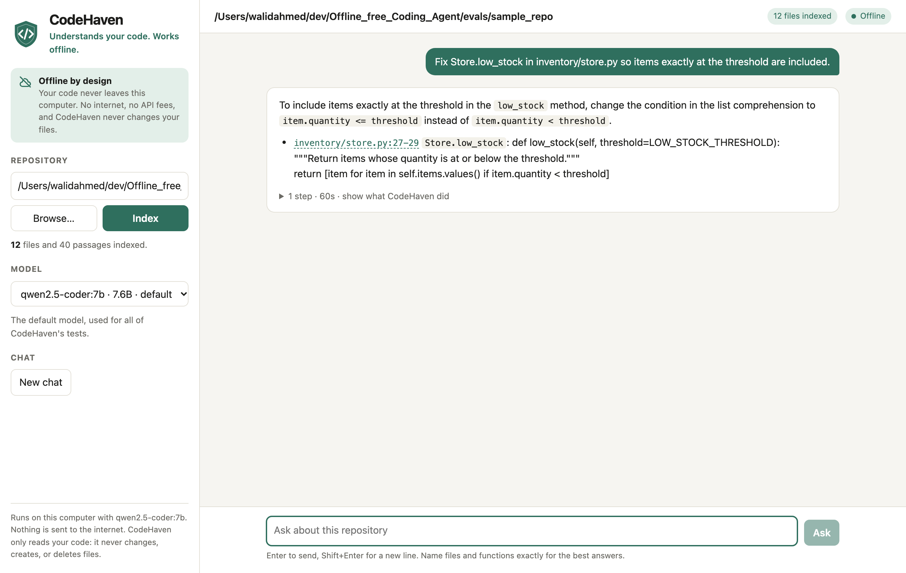

# CodeHaven

*Your code. Your machine. No API fees.*


**CodeHaven helps you understand a codebase, entirely offline.** Open it in your browser, point it at a project, and ask how something works, where something is used, or what a file does. Answers cite the exact lines they rely on, and one click shows those lines. It runs on a local Ollama model (`qwen2.5-coder:7b` by default), so your code never leaves your computer and there are no API fees.

> **CodeHaven is read-only.** It reads, searches, and explains, and it never changes, creates, or deletes your files. Ask it to fix something and it explains what to change and where, with cited lines and the new code, and leaves the edit to you. No code path in this version writes files.



Version 0.9.1. No cloud inference, automatic downloads, or tracing: LangGraph runs the workflow locally and model requests go straight to Ollama on `127.0.0.1`. You can also use CodeHaven from the terminal.

## Get started

You need Python 3.10+ and [Ollama](https://ollama.com/). While you are online, do this once:

```sh
# 1. Start Ollama with cloud features off (leave this terminal open)
python3 scripts/start_ollama.py

# 2. In another terminal, download the default model
ollama pull qwen2.5-coder:7b

# 3. Install CodeHaven in a virtual environment
python3 -m venv .venv
source .venv/bin/activate        # Windows PowerShell: .venv\Scripts\Activate.ps1
python -m pip install -e .
```

After that, everything works offline. Each time, activate the environment and open the browser page:

```sh
source .venv/bin/activate
codehaven --gui
```

## Chat in your browser

`codehaven --gui` opens a page in your browser:

1. **Pick a repository.** Type its path or click **Browse…** (Git repositories are marked), then click **Index**. Indexing a typical project takes a few seconds, and the page shows how many files it indexed. Recent repositories are listed for one-click reopening.
2. **Pick a model.** The sidebar lists the chat models installed in Ollama on this computer, with `qwen2.5-coder:7b` selected when it is installed. That default is the model all of CodeHaven's tests were tuned and measured on; other models may answer differently, and the first answer after switching is slower while the model loads. Cloud-backed and embedding-only models are never offered.
3. **Ask questions.** Answers stream in as they are written. Follow-up questions see your earlier questions and answers, and **New chat** starts over. Try "Explain this project", "Which function calls `checkout_total`?", or "Explain `src/app.py`".
4. **Check the code.** Click a citation such as `inventory/store.py:27-29` to open those lines, highlighted, beside the chat.
5. **See how it got there.** Each answer can show the steps CodeHaven took. If a citation could not be checked against what was actually read, a yellow **Unverified** box says so.

Tips for good answers: name files and functions exactly (`Store.low_stock`, not "the stock function"), and ask one thing at a time.

**How follow-up memory works.** Each new question is sent with a short record of the conversation, not the whole chat, so the model keeps room for the code itself. The last two answers are kept nearly whole (up to 1,000 characters each), because follow-ups such as "and what does *it* return?" refer to them. Up to six older questions are kept as the question plus the first sentence of its answer. The whole record stays under about 3 KB, a quarter of the default prompt budget; the oldest questions are dropped first. The file paths and line ranges found so far are also carried forward, so follow-ups can cite them without searching again. Detailed tool output, such as file text read for an earlier question, is not carried over; the model reads it again if needed. The sidebar shows how many earlier questions are remembered. **New chat**, or reloading the page, starts with an empty memory; start one whenever you change topic, because an old topic can steer a new answer.

**Private and offline by design.** The page is served from `127.0.0.1` only and loads nothing from the internet: its Content-Security-Policy blocks any outside script, style, or font. Requests must carry a secret token from the link printed in the terminal and name this machine in their Host header, so other websites open in your browser cannot use the server to read your files. The page never runs tests. Only the list of recent repositories is kept, in your browser's local storage.

Options: `--workspace /path/to/repo` indexes a repository at startup, `--model NAME` picks the starting model, `--port 8737` sets a fixed port, and `--no-browser` prints the link instead of opening it. Ctrl+C in the terminal stops the server.

If every answer takes a minute or more, another program is probably using a different Ollama model at the same time; see [Local inference speed](#local-inference-speed).

## Use it from the terminal

The same assistant works without the browser. Check that Ollama and the model are ready, then ask a question:

```sh
codehaven --doctor
codehaven --workspace /absolute/path/to/project 'Explain this project'
```

Ask for a change and you get an explanation, not an edit:

```sh
codehaven --workspace /absolute/path/to/project \
  'Fix Store.low_stock so items exactly at the threshold are included'
```

The answer names the lines to change (here `inventory/store.py:27-29`), says what to change them to (`<` becomes `<=`), and leaves your file untouched.

For several questions in a row, start an interactive session. Follow-ups remember up to eight earlier questions, the same way as in the browser page, and the index refreshes between questions. A single `codehaven 'question'` command has no memory. Type `/reset` to forget earlier answers and `exit` to quit:

```sh
codehaven --workspace /absolute/path/to/project --interactive
```

Answers stream to the terminal as the model writes them; add `--no-stream` to print each answer only once it is complete. `codehaven`, `offline-agent`, and `python -m offline_agent` are the same command (on Windows, use `python -m offline_agent`). Reinstall the package after updating to register the commands.

## Choosing a model

`qwen2.5-coder:7b` is the default and the tested model. To use another installed local model, choose it in the browser page or pass `--model`:

```sh
codehaven --model qwen2.5:14b --workspace /path/to/project 'Explain this project'
```

Names of cloud models (ending in `-cloud` or `:cloud`) are refused, and so are models Ollama reports as remote-backed or embedding-only. With `--gui`, if the default model is not installed, CodeHaven starts with another installed chat model.

## Ollama and offline use

The [startup script](scripts/start_ollama.py) sets `OLLAMA_NO_CLOUD=1` and binds the server to `127.0.0.1:11434`, following [Ollama's local-only instructions](https://docs.ollama.com/faq). Run it from this repository on macOS, Linux, or Windows (use `python` if that is your Python command). Leave that terminal open; Ctrl+C stops the server. Check its logs for `Ollama cloud disabled: true`.

If Ollama is already running, the script checks its local API, prints a friendly message, and exits successfully without launching a second server. It cannot change or verify that server's cloud setting. To enforce `OLLAMA_NO_CLOUD=1`, quit the existing desktop app or stop its service, then run the script again. An unrecognized listener on the port still produces an error. These environment settings apply only to a server launched by the script.

After downloading a model, disconnect from the internet to use it offline. Disabling cloud features does not block model downloads or all network traffic. CodeHaven checks that the model is installed and rejects remote-backed and cloud models; a loopback URL alone cannot guarantee how a separately configured server performs inference. Installation downloads LangGraph and its dependencies; runtime does not require internet access.

## LangGraph workflow


A high-resolution [PNG version](docs/assets/how-codehaven-works.png) is available for slides.

```text
START -> model -> read, search, retrieve, or run_tests -> model
             |-> invalid reply -> correction message -> model (once)
             \-> finish -> END
                    tool at action limit -> limit -> END
```

The graph holds conversation messages, the current action, the action count, and the exit code in memory. It uses conditional edges to dispatch actions. There is no node that writes files. The action limit counts model responses, not internal graph nodes. Graph recursion has a separate guard sized to that limit. This version does not add persistent checkpoints.

If the model returns invalid JSON, an unknown action (including `edit` or `write`, which do not exist), missing fields, or a reply cut off at the token limit, no tool runs. The model gets one correction message explaining what was wrong, and the retry counts as a step. A second invalid reply in a row stops the task with exit code 1. Failures to reach Ollama are never retried.

Small models at temperature 0 sometimes repeat the same sentences until they hit the token limit. Replies are always streamed from Ollama, so a final answer that keeps repeating a phrase is stopped as soon as the loop is detected. The text before the repetition is kept as the answer, marked with a note. An answer that reaches its length limit ends at its last complete sentence, also with a note.

Identical actions are caught anywhere in a task, not only back to back, so alternating lookups stop early instead of using every step. An action may be repeated after compaction has removed its earlier result.

Implementation follows the [LangGraph graph API](https://docs.langchain.com/oss/python/langgraph/graph-api). Remote tracing is not supported. Every run is wrapped in [`tracing_context(enabled=False)`](https://docs.langchain.com/langsmith/trace-without-env-vars), so `LANGSMITH_TRACING`, `LANGCHAIN_TRACING_V2`, or an API key in your environment cannot turn uploads on. No tracing client is ever created. For timing and token details, use the local `Ollama metrics:` line printed after each model call.

## What v0.9 does

- Never changes files. The only actions are `read`, `search`, `retrieve`, `run_tests`, and `finish`, and the workspace layer has no write method.
- Lists up to 1,000 visible project files and lets the model read selected UTF-8 files.
- Reads long files in pages. Content such as `120-180` asks for a line range. A read that would not fit in half the prompt budget returns whole lines up to that size and names the next range to request, so evidence is never silently truncated.
- Preloads up to two files that your task names, such as `explain chapter-06/gateway/app/main.py`, with line numbers for citing. The model starts with the file's lines instead of spending steps finding and reading it, and those lines count as evidence for citations. A file too long to fit shows its start, its end, and the lines around any code-like name in the task, such as `SKU-0042`, because the answer is often not on the first page. A plain file name like `store.py` counts only if exactly one file has that name. Hidden and excluded files are never preloaded.
- Searches the project for code names in a question, such as `apply_discount` or `applyCoupon`, before the model's first step, and shows each match with the function it is in. Left alone, the model often answered "who calls X?" from the definition without searching.
- Answers questions and change requests in a stricter format: an answer plus up to 10 points. Each point names a part of the code: a function, class, `Class.method`, variable, route such as `/health`, `imports`, a whole file, or a line such as a table row. CodeHaven finds that part's real lines and prints `path:start-end` from them, because small models describe code well but make up line numbers. Python files are parsed, never run; other names match the first line that mentions them. A point naming a file beside the wrong folder is matched to the one file with that name. A range is narrowed to the lines the model actually saw. A name that cannot be found is shown as not found and flagged. Explaining a named file limits the overview to a short paragraph.
- Search results name the enclosing function or class of each match and mark definitions.
- Runs unittest or pytest in isolated Docker containers after approval, with networking disabled, read-only project snapshots, a 30-second timeout, and bounded output. Tests cannot change your project.
- Keeps long tasks within the prompt budget by first replacing older tool results and file contents with one-line stubs, oldest first, such as `Tool result for read big.py … [Older result compacted: 9,412 bytes omitted]`. Older messages are dropped only if that is not enough.
- Limits reads to 64 KB per file and tasks to 12 steps by default (maximum 30).
- Rejects traversal, hidden paths, and symlinks.
- Connects only to numeric HTTP loopback endpoints, with proxies and redirects disabled.

Use `--endpoint http://127.0.0.1:11434` for a different local port and `--max-steps 20` for longer tasks. Exit codes: 0 finished/doctor passed, 1 error, 2 step limit or unverified answer, 130 interrupted. A checked answer is not proof that the explanation is right; read the cited lines.

## File exclusions

File listing, search, RAG indexing, dependency retrieval, and direct reads respect root and nested `.gitignore` / `.agentignore` rules. Add persistent agent-only rules to `.agentignore`, or pass extra patterns:

```sh
codehaven --workspace /path/to/repo \
  --exclude 'private/**' --exclude '*.pem' 'Explain this project'
```

Hidden/built-in paths stay blocked. User exclusions add restrictions; they cannot undo Git ignores. Rules apply to tracked files too. [Exclusion details](docs/EXCLUSIONS.md) cover precedence, negation, root scope, and reference libraries.

## Local reference knowledge base (RAG)

The repository selected by `--workspace` is automatically indexed for RAG. CodeHaven retrieves relevant source code, README/documentation, and common configuration/build files before answering, with citations such as `repo/src/orders.py:1-25`. No separate indexing command is needed. For Python and JavaScript/TypeScript, retrieval also follows local imports up to two hops and adds relevant dependency passages, even when they do not match the question keywords.

```sh
codehaven --workspace /path/to/repo 'Explain how order validation works'
```

**You can also add your own reference documents.** Put `.md`, `.txt`, or `.rst` files in your project's `knowledge/` folder, or use `--knowledge-base /path/to/references`. Bundled LangGraph documentation notes cover graph construction, checkpointing, and approval interrupts, with official source links. They are available to RAG automatically, offline, and are project-authored notes rather than the complete official manual. Reference folders inside the workspace must be allowed by its ignore rules. If `knowledge/` is ignored (as in this repository), use an external reference library instead.

```sh
codehaven --workspace /path/to/project --knowledge-base /path/to/references \
  'Use my references to explain LangGraph conditional edges'
```

The model can call `retrieve` for more passages, with source and line citations. Indexing and retrieval run entirely on your device using BM25 keyword ranking. No vector database, embeddings, extra model, or internet access is needed. Startup reports the repository-file count and warns if index limits were reached. The index is rebuilt at the start of each run and between questions in a session, so edits you make yourself are picked up. See [how to add manuals and your own references](docs/KNOWLEDGE_BASE.md) for supported formats, limits, and examples.

## Dependency-aware retrieval and complete functions

If `orders.py` imports a helper from `pricing.py`, retrieval can include the pricing definition too. Python AST and local Tree-sitter JavaScript/TypeScript parsers analyze code without executing it. Supported JS/TS imports include relative ES imports, re-exports, literal `require()`, directory `index` files, and common `.js` specifiers pointing to `.ts` source. Package imports, computed/dynamic paths, and tsconfig/bundler aliases remain unresolved.

Retrieval prefers complete parsed functions, methods, classes, and supported TS declarations when they fit. Results mark `symbol_complete: true` for full symbols or `false` when falling back to a partial excerpt. A symbol also carries the values of up to three module constants it uses, such as `MAX_GUESTS = 4`, because the answer is often the value rather than the name. Retrieval considers different files before repeatedly selecting chunks from one file, reserves space for dependencies, and skips candidates that cannot fit instead of ending retrieval immediately.

Words are reduced to simple stems and identifiers are split at underscores and camelCase, so "restocking" finds `restock` and "apply discount" finds both `applyDiscount` and `apply_discount`. The bundled LangGraph notes are left out of results when a question does not mention LangGraph and the project has matches of its own.

Up to four keyword matches and four dependency passages share a configurable UTF-8 JSON budget (CLI default 4,000 bytes). For example:

```sh
codehaven --workspace /path/to/repo --retrieval-budget 8000 \
  'Explain checkout_total and its imported helpers'
```

`--retrieval-budget` accepts 2,000–16,000 bytes. It controls retrieved context only; it does not measure model tokens or cap accumulated conversation history. Imports are followed up to two hops over already indexed files. See [retrieval details](docs/KNOWLEDGE_BASE.md#retrieval-budgets-and-complete-symbols) for metadata and limitations.

## Local inference speed

**Check this first if every step takes a minute or more.** Ollama unloads a model when another one needs the memory. If another program is using a different model at the same time and both do not fit, Ollama swaps them on every request, and most of each step goes to reloading. This has been measured at 35–113 seconds of loading per step on a 24 GB machine. CodeHaven warns at startup when another model is loaded, and warns during a run when a later step had to reload. Check with `ollama ps`, and stop the other program for much faster runs.

Model requests wait up to 10 minutes for a response, so a slow reload does not fail the task.

CodeHaven sends a task-ranked sample of at most 40 paths / 2,000 bytes instead of the entire file list. Ollama requests keep the model loaded for 30 minutes and preserve the conversation prefix until compaction is necessary, allowing server prompt-cache reuse when available. There is no persistent application cache, and only sessions (`--interactive` or the browser page) carry recent answers between questions. Another client or model unloading can prevent reuse.

`--prompt-budget` bounds message content plus a small per-message allowance (default 12,000 UTF-8 bytes). Older evidence is omitted when necessary; oversized recent evidence is marked incomplete. System rules and the original task stay. This is a byte budget, not an exact token count. Full graph history stays in RAM. Requests reserve a context window of at least 8,192 tokens, increasing with the configured budgets; larger settings consume more memory and may run slower.

Responses are limited to 1,024 tokens per action. A response stopped by that limit is rejected before any action is executed. For longer answers, raise the limits:

```sh
codehaven --max-output-tokens 4096 --prompt-budget 24000 \
  --workspace /path/to/project 'Explain the whole request pipeline'
```

Output limits accept 256–8,192 tokens; prompt budgets accept 8,000–64,000 bytes. Small tasks with the defaults should require less prompt processing, but performance still depends on hardware, context, and Ollama. No fixed speed improvement is guaranteed.

Progress lines such as `Step 1 (max 12): read inventory/store.py` show the actual action and target alongside the model's narration. An identical repeated action is skipped and triggers one finish-only recovery call, within the action limit. If the model ignores recovery, the run stops with exit code 2. A step-limit exit also means the task is incomplete; intermediate tool narration is not a final answer. This guard catches repeated lookup requests, not every possible reasoning loop or incorrect answer.

The final call in `--max-steps` is reserved for an answer: a four-step run permits up to three tool actions and one final response. The final response must summarize available evidence and disclose gaps. With `--max-steps 1`, no tools can run. If the model ignores the finish-only schema, the run exits incomplete without executing its proposed tool. This reserves time to answer; it cannot guarantee that the model's answer is correct or complete.

Search, read, and retrieved evidence is retained with paths, line ranges, short snippets, and heuristic labels (`service`, `test`, `stub`, `reference`, `source`). The bounded list holds up to 50 records / 4,000 bytes; snippets are dropped before citations when space runs low. It is supplied again on the final reserved call, so older discoveries survive conversation trimming. Classification is a hint, not a deployment guarantee.

Explicit requests to find/list/identify FastAPI entry points use a local discovery node: search broadly for the exact literal `FastAPI(`, classify matches, then request one cited summary. It scans eligible files beyond the RAG document limit, within the search tool's bounds, and avoids a model-driven read of every match. Other tasks keep the normal tool workflow. This first planner does not detect aliased constructors, application factories without this literal, or other frameworks. It never proves that every entry point has been found.

Final-answer checks require observed path:line citations for questions and change requests when evidence exists, reject unsupported citation ranges, and flag a singular-entry-point claim when multiple service candidates were found. Planned discovery also checks that each retained service candidate has a supported citation. Answers with detected gaps are displayed as **unverified** and exit with code 2. These are bounded syntax and coverage checks, not semantic verification of every claim; evidence can be partial. Final answers print once, without duplicating progress narration.

Discovery summaries use a short dedicated prompt and a bounded response schema. Checks also flag repeated substantial lines and test/stub paths listed under a conflicting recognized heading. If a discovery summary fails checks, it is withheld and replaced with the classified source inventory plus the specific warnings. The raw model reply remains in run state; the source inventory does not silently turn a rejected model summary into a verified answer.

After each model response, CodeHaven shows the timing fields Ollama supplies: model loading, prompt evaluation, generation and total seconds, prompt/generated token counts, and generation tokens per second. `cached_tokens` is a reported count when present, or `null` when Ollama does not report it. Missing cache metrics never imply a cache hit. Timings are per request, not an end-to-end task benchmark. See the [Ollama response fields](https://docs.ollama.com/api/chat).

## Search file contents

```sh
codehaven --workspace /absolute/path/to/project 'Search for validate_order and explain where it is used'
```

The model can call `search` with the literal query in `content` and an optional relative file or directory in `path`. An empty path searches the workspace. Search needs no approval. Matching is case-sensitive, single-line, and literal (no regex); queries must be nonblank and at most 256 characters.

Results contain relative paths, 1-based line numbers, up to 320 characters of text around the first match on each matching line, and the function or class each match is in. Search returns at most 50 matching lines and 16,000 bytes of JSON. It considers up to 1,000 eligible files per scope and skips hidden/excluded paths, symlinks, files over 64 KB, binary data, unreadable files, and invalid UTF-8. Narrow the scope when a limit is reported. `files_searched` and `files_skipped` describe attempted candidates; `limit_reached` and `candidate_limit_reached` flag potentially incomplete results. A no-match result only describes the files actually searched. Search uses the same ignore and exclusion policy as file listing and RAG. The terminal shows a short summary (counts, limits, and up to 20 `path:line` matches); the model always receives the full JSON.

Search results also report the exact `query`, `scope`, and `literal: true`. Queries are source text, not filename filters: searching for `FastAPI(` finds constructors; `FastAPI(.py` searches for those exact characters and will usually find nothing. File extensions and globs must not be appended to the query.

## Run isolated project tests

Start a local Docker Linux-container runtime and prepare the image once while online:

```sh
docker build -t offline-agent-tests:0.7.0 sandbox
```

Then request either unittest (the default) or pytest:

```sh
codehaven --workspace /path/to/project --test-runner pytest \
  'Run tests and explain failures'
```

CodeHaven asks for approval before each run. Tests receive a filtered, read-only project copy, disabled networking, and a writable temporary area. They cannot change the original project through the mounted filesystem. Host environment variables and the Docker socket are not exposed. Time/resource/output limits and forced container cleanup apply.

**No host fallback:** Docker and a prepared local image are required. CodeHaven never pulls images or installs packages during a test run. For project dependencies, prepare an image and select `--test-image my-project-tests:local`. See [isolated test setup and limits](docs/ISOLATED_TESTS.md).

## Current limits

CodeHaven is read-only, but its file tools are not an OS sandbox: they rely on path checks, which are not hardened against hostile filesystem races. Avoid moving files or directories around while it runs. It runs only the fixed test commands described above and cannot accept arbitrary commands or install dependencies.

Hidden files are skipped, but visible files can still contain secrets. Only point CodeHaven at projects you intend to expose to your local model. Conversation context accumulates within a task. Compaction keeps it within `--prompt-budget`, but stubbed results must be read again if the model needs them. Sessions remember up to eight recent questions, with older answers reduced to their first sentence, and the cited locations found so far. Nothing is saved to disk between sessions. Model prose is untrusted and may make unsupported claims, so read the cited lines.

## Development

```sh
python3 -m unittest discover -s tests -v
python3 -m compileall -q offline_agent tests
```

Tests include a simulated agent workflow, a real loopback HTTP fixture, and the browser page's server, without downloading a model.

### Evaluate the local model

To measure whether a prompt or tool change actually helps the model, run the fixed eval tasks against your local Ollama:

```sh
python3 -m offline_agent.evaluation
python3 -m offline_agent.evaluation --only low-stock-bug --only last-product
```

To check that a change is not fitted to those tasks, also run the [second set](evals/bookings_tasks.json) over a [different small repository](evals/bookings_repo). Results are recorded in [the plan](docs/PLAN.md):

```sh
python3 -m offline_agent.evaluation --tasks evals/bookings_tasks.json --repo evals/bookings_repo
```

[evals/tasks.json](evals/tasks.json) holds 12 questions over the small [sample repository](evals/sample_repo), including a paged read of a 600-line file, entry-point discovery, and explaining a bug and its fix. Every task is a question checked by regexes on the answer; three tasks also ask follow-up questions in the same session ("What tax rate does *that function* add?"), each checked on its own answer, to test the follow-up memory. Each task runs on a fresh temporary copy with test runs declined, and **a task fails if any file in the copy changed**, so the evals also check that CodeHaven stays read-only. The run prints a table of pass/fail, exit code, steps, tokens, and time, and writes the full report, including each task's run log, raw model replies, and changed files, to `evals/results/latest.json`, which Git ignores. The summary separately counts tasks that also passed CodeHaven's own answer checks (exit code 0), and warns if model reloads made the timings unrepresentative. Use `--model` to score another installed model. Like normal use, evaluation talks only to loopback Ollama. Compare reports before and after a change. Results vary between runs, so look at trends rather than one pass or fail.

See [the implementation plan and roadmap](docs/PLAN.md) for architecture, acceptance criteria, and next steps. API integration follows [Ollama chat](https://docs.ollama.com/api/chat) and [structured outputs](https://docs.ollama.com/capabilities/structured-outputs).

Automated tests use fake model responses and a loopback HTTP fixture, so they do not establish answer quality. The local evals measure the real model, but only on short questions over two small repositories, so they do not establish quality on larger projects either.
