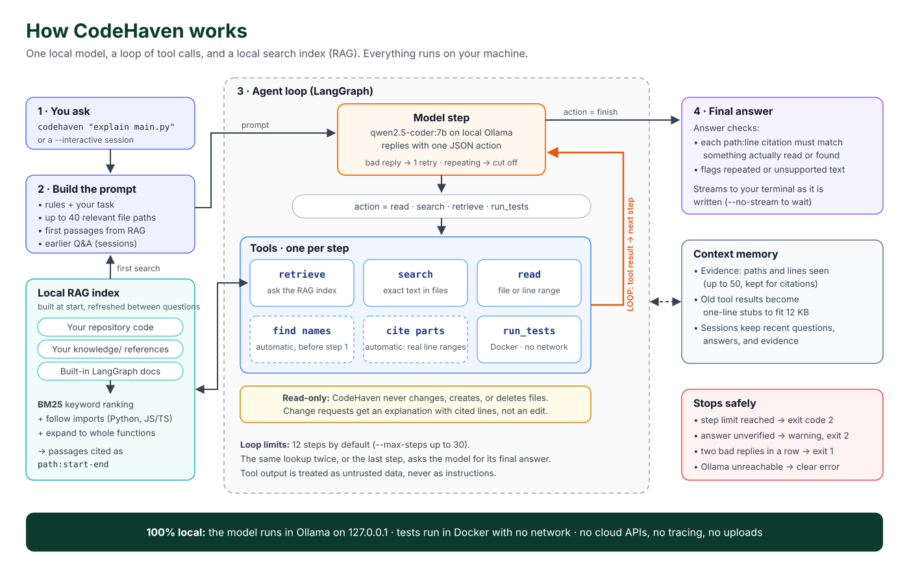

# CodeHaven

*Your code. Your machine. No API fees.*


Version 0.8.0 — a small command-line coding agent that uses only the installed local `qwen2.5-coder:7b` Ollama model. Ask it to inspect a project, explain code, or propose file changes. No cloud inference, automatic downloads, or tracing. LangGraph orchestrates the workflow locally; model requests go directly to Ollama. At runtime nothing leaves your device.

## Quick start

Requirements: Python 3.10+ and [Ollama](https://ollama.com/). Install Ollama and download `qwen2.5-coder:7b` while connected to the internet. This is the only supported model; there is no model-selection option or fallback. Speed and memory use depend on your device.

```sh
python3 scripts/start_ollama.py
# In another terminal, while online:
ollama pull qwen2.5-coder:7b
```

The [startup script](scripts/start_ollama.py) sets `OLLAMA_NO_CLOUD=1` and binds the server to `127.0.0.1:11434`, following [Ollama's local-only instructions](https://docs.ollama.com/faq). Run it from this repository on macOS, Linux, or Windows (use `python` if that is your Python command). Leave that terminal open; Ctrl+C stops the server. Check its logs for `Ollama cloud disabled: true`.

If Ollama is already running, the script checks its local API, prints a friendly message, and exits successfully without launching a second server. It cannot change or verify that server's cloud setting. To enforce `OLLAMA_NO_CLOUD=1`, quit the existing desktop app or stop its service, then run the script again. An unrecognized listener on the port still produces an error. These environment settings apply only to a server launched by the script.

After downloading a model, disconnect from the internet to use it offline. Disabling cloud features does not block model downloads or all network traffic. The agent checks that the model is installed and rejects remote-backed model metadata; a loopback URL alone cannot guarantee how a separately configured server performs inference.

Install the Python dependencies once while online, then activate the environment each time you open a new terminal:

```sh
python3 -m venv .venv
# macOS / Linux:
source .venv/bin/activate
# Windows PowerShell instead:
# .venv\Scripts\Activate.ps1
python -m pip install -e .
```

Once installed, the agent runs offline with the downloaded model:

```sh
python3 -m offline_agent --doctor
python3 -m offline_agent \
  --workspace /absolute/path/to/project \
  'Explain this project and suggest a small improvement'
```

By default, changes are previews. To write files, enable `--apply` and type `y` at each file prompt:

```sh
python3 -m offline_agent \
  --workspace /absolute/path/to/project --apply \
  'Read the calculator module and add input validation'
```

For several questions in a row, start an interactive session. Follow-ups see earlier questions and answers, and the index refreshes between tasks. Type `/reset` to forget earlier answers and `exit` to quit:

```sh
python3 -m offline_agent --workspace /absolute/path/to/project --interactive
```

To chat in your browser instead, start the local page:

```sh
codehaven --gui
```

It opens a page where you pick a repository (type its path or browse folders), index it, and ask questions. Answers stream in, follow-up questions see earlier answers, and **New chat** starts over. Click a citation such as `pricing.py:17` to see those lines. Each answer can show the steps CodeHaven took, and warnings about citations it could not verify. Add `--workspace /path/to/repo` to index a repository at startup, `--port 8737` for a fixed port, or `--no-browser` to print the link instead of opening it.

The page is served from `127.0.0.1` only, and loads nothing from the internet: its Content-Security-Policy blocks any outside script, style, or font. Requests must carry a secret token from the printed link and name this machine in their Host header, so other websites open in your browser cannot use the server to read your files. Chat in the page is read-only: proposed edits are shown as previews and never written, and tests are never run. Only the list of recent repositories is kept, in your browser's local storage. Ctrl+C in the terminal stops the server.

Final answers stream to the terminal as the model writes them. Use `--no-stream` to print each answer only when it is complete.

After installation, you can replace `python3 -m offline_agent` with `codehaven`. The existing `offline-agent` command remains supported (on Windows, use `python -m offline_agent`). Reinstall the package after updating to register the new command. Installation downloads LangGraph and its dependencies; runtime does not require internet access.

## LangGraph workflow



A high-resolution [PNG version](docs/assets/how-codehaven-works.png) is available for slides.

```text
START -> model -> read, search, retrieve, edit, write, or run_tests -> model
             |-> invalid reply -> correction message -> model (once)
             \-> finish -> END
                    tool at action limit -> limit -> END
```

The graph holds conversation messages, the current action, the action count, and the exit code in memory. It uses conditional edges to dispatch actions. Each write still requires your confirmation in `--apply` mode. The action limit counts model responses, not internal graph nodes. Graph recursion has a separate guard sized to that limit. This version does not add persistent checkpoints or automatic retries of writes.

If the model returns invalid JSON, an unknown action, missing fields, or a reply cut off at the token limit, no tool runs. The model gets one correction message explaining what was wrong, and the retry counts as a step. A second invalid reply in a row stops the task with exit code 1. Failures to reach Ollama are never retried.

Small models at temperature 0 sometimes repeat the same sentences until they hit the token limit. Replies are always streamed from Ollama, so a final answer that keeps repeating a phrase is stopped as soon as the loop is detected. The text before the repetition is kept as the answer, marked with a note. Forced final answers are also capped at 3,000 characters. The repeat penalty is left unchanged on purpose, because edits must copy file text exactly.

Identical actions are caught anywhere in a task, not only back to back, so alternating lookups and repeated failed edits stop early instead of using every step. An action may be repeated after a file changes, or after compaction has removed its earlier result.

Implementation follows the [LangGraph graph API](https://docs.langchain.com/oss/python/langgraph/graph-api). Remote tracing is not supported. Every run is wrapped in [`tracing_context(enabled=False)`](https://docs.langchain.com/langsmith/trace-without-env-vars), so `LANGSMITH_TRACING`, `LANGCHAIN_TRACING_V2`, or an API key in your environment cannot turn uploads on. No tracing client is ever created. For timing and token details, use the local `Ollama metrics:` line printed after each model call.

## What v0.8 does

- Lists up to 1,000 visible project files and lets the model read selected UTF-8 files.
- Uses structured JSON actions to read, search file contents, retrieve references, edit part of a file, propose a complete file, run tests, or finish.
- Reads long files in pages. Content such as `120-180` asks for a line range. A read that would not fit in half the prompt budget returns whole lines up to that size and names the next range to request, so evidence is never silently truncated.
- Preloads up to two files that your task names, such as `explain chapter-06/gateway/app/main.py`. The model starts with the file's lines instead of spending steps finding and reading it, and those lines count as evidence for citations. A file too long to fit shows its start, its end, and the lines around any code-like name in the task, such as `SKU-0042`, because the answer is often not on the first page. A plain file name like `store.py` counts only if exactly one file has that name. Hidden and excluded files are never preloaded. Questions get line numbers to cite. Change requests get plain text, so SEARCH blocks stay exact.
- Questions are read-only: when a task clearly only asks something, `edit` and `write` are not offered, so "Which function calls X?" cannot turn into a code change. Tasks that are unclear keep every tool.
- Answers to questions use a stricter format: an answer plus up to 10 points. Explaining a named file limits the overview to a short paragraph. Each point names a part of the code: a function, class, `Class.method`, variable, route such as `/health`, or `imports`. CodeHaven finds that part's real lines in the file and prints `path:start-end` from it, because small models describe code well but make up line numbers. Python files are parsed, never run; other files use the first line that mentions the name. A name that isn't in the file is shown as not found and flagged, and citations are checked against the lines the model actually saw. The format also stops the long, padded answers that small models drift into. A range is narrowed to the lines the model actually saw.
- Edits existing files with SEARCH/REPLACE blocks, so changing a few lines of a large file costs a few output tokens instead of a full rewrite. Each SEARCH text must match exactly once, though prose around the blocks and lost indentation are tolerated. A SEARCH text that matches nothing gets an error showing the closest lines in the file.
- Also accepts an edit that is simply the new version of some lines, because that is what the local model tends to write. Lines shared with the file locate the region, and the rest of the file is untouched. The change is refused if the place is ambiguous, the content has little in common with the file, or it would remove much more than it shows. All edits use the same diff preview and per-file confirmation as writes.
- Refuses a whole-file `write` that would lose code: one containing a placeholder such as `# ... rest of the file ...`, or one removing more than half of a file of 20 or more lines, unless the task asks for that. A `write` holding only part of a file updates that part. Writes replace the file atomically, so a crash or full disk cannot leave it half-written, and they keep the file's permissions and line endings.
- A change task that ends without a change gets one reminder, and is then reported as unverified with exit code 2. A report that a change was made does not need line citations.
- Search results name the enclosing function or class of each match and mark definitions, so "who calls this?" is answered by the result itself.
- Runs unittest or pytest in isolated Docker containers after approval, with networking disabled, read-only project snapshots, a 30-second timeout, and bounded output.
- Shows unified diffs before edits, with confirmation for each write.
- Parses proposed `.py` and `.pyi` content with `ast.parse` before showing a diff. The parser never runs the code. A change that introduces a syntax error is neither previewed nor written. Instead, the model gets the error line so it can fix the change. Files that were already broken are not blocked.
- Keeps long tasks within the prompt budget by first replacing older tool results and file contents with one-line stubs, oldest first, such as `Tool result for read big.py … [Older result compacted: 9,412 bytes omitted]`. Older messages are dropped only if that is not enough.
- Limits reads/writes to 64 KB per file and tasks to 12 steps by default (maximum 30).
- Rejects traversal, hidden paths, symlinks, and hard-linked write targets.
- Connects only to numeric HTTP loopback endpoints, with proxies and redirects disabled.

Use `--endpoint http://127.0.0.1:11434` for a different local port and `--max-steps 20` for longer tasks. Exit codes: 0 finished/doctor passed, 1 error, 2 step limit, 130 interrupted. Model completion does not establish that generated code is correct.

## File exclusions

File listing, search, RAG indexing, and dependency retrieval now respect root and nested `.gitignore` / `.agentignore` rules. Direct file reads and writes also reject excluded paths. Add persistent agent-only rules to `.agentignore`, or pass extra patterns:

```sh
offline-agent --workspace /path/to/repo \
  --exclude 'private/**' --exclude '*.pem' 'Explain this project'
```

Hidden/built-in paths stay blocked. User exclusions add restrictions; they cannot undo Git ignores. Rules apply to tracked files too. [Exclusion details](docs/EXCLUSIONS.md) cover precedence, negation, root scope, and reference libraries.

## Local reference knowledge base (RAG)

The repository selected by `--workspace` is automatically indexed for RAG. The agent retrieves relevant source code, README/documentation, and common configuration/build files before answering, with citations such as `repo/src/orders.py:1-25`. No separate indexing command is needed. For Python and JavaScript/TypeScript, retrieval also follows local imports up to two hops and adds relevant dependency passages, even when they do not match the question keywords.

```sh
offline-agent --workspace /path/to/repo 'Explain how order validation works'
```

**You can also add your own reference documents.** Put `.md`, `.txt`, or `.rst` files in your project's `knowledge/` folder, or use `--knowledge-base /path/to/references`. Bundled LangGraph documentation notes cover graph construction, checkpointing, and approval interrupts, with official source links. They are available to RAG automatically, offline, and are project-authored notes rather than the complete official manual. Reference folders inside the workspace must be allowed by its ignore rules. If `knowledge/` is ignored (as in this repository), use an external reference library instead.

```sh
offline-agent --workspace /path/to/project --knowledge-base /path/to/references \
  'Use my references to explain LangGraph conditional edges'
```

The agent retrieves relevant passages automatically and can call `retrieve` for more, with source and line citations. Indexing and retrieval run entirely on your device using BM25 keyword ranking. Startup reports the repository-file count and warns if index limits were reached. The index refreshes after an approved agent write and at the start of each new task. No extra model, internet access, embeddings, or vector database is needed. See [how to add manuals and your own references](docs/KNOWLEDGE_BASE.md) for supported formats, limits, and examples.

## Dependency-aware retrieval and complete functions

If `orders.py` imports a helper from `pricing.py`, retrieval can include the pricing definition too. Python AST and local Tree-sitter JavaScript/TypeScript parsers analyze code without executing it. Supported JS/TS imports include relative ES imports, re-exports, literal `require()`, directory `index` files, and common `.js` specifiers pointing to `.ts` source. Package imports, computed/dynamic paths, and tsconfig/bundler aliases remain unresolved.

Retrieval prefers complete parsed functions, methods, classes, and supported TS declarations when they fit. Results mark `symbol_complete: true` for full symbols or `false` when falling back to a partial excerpt. It considers different files before repeatedly selecting chunks from one file, reserves space for dependencies, and skips candidates that cannot fit instead of ending retrieval immediately.

Identifiers are split at underscores and camelCase, so `applyDiscount` and `apply_discount` both match "apply discount". The bundled LangGraph notes are left out of results when a question does not mention LangGraph and the project has matches of its own.

Up to four keyword matches and four dependency passages share a configurable UTF-8 JSON budget (CLI default 4,000 bytes). For example:

```sh
offline-agent --workspace /path/to/repo --retrieval-budget 8000 \
  'Explain checkout_total and its imported helpers'
```

`--retrieval-budget` accepts 2,000–16,000 bytes. It controls retrieved context only; it does not measure model tokens or cap accumulated conversation history. Imports are followed up to two hops over already indexed files. See [retrieval details](docs/KNOWLEDGE_BASE.md#retrieval-budgets-and-complete-symbols) for metadata and limitations.

## Local inference speed

**Check this first if every step takes a minute or more.** Ollama unloads a model when another one needs the memory. If another program is using a different model at the same time and both do not fit, Ollama swaps them on every request, and most of each step goes to reloading. This has been measured at 35–113 seconds of loading per step on a 24 GB machine. CodeHaven warns at startup when another model is loaded, and warns during a run when a later step had to reload. Check with `ollama ps`, and stop the other program for much faster runs.

Model requests wait up to 10 minutes for a response, so a slow reload does not fail the task.

CodeHaven sends a task-ranked sample of at most 40 paths / 2,000 bytes instead of
the entire file list. Ollama requests keep the model loaded for 30 minutes and
preserve the conversation prefix until compaction is necessary, allowing server
prompt-cache reuse when available. There is no persistent application cache, and only
`--interactive` sessions carry recent answers between tasks. Another client or model unloading can prevent reuse.

`--prompt-budget` bounds message content plus a small per-message allowance
(default 12,000 UTF-8 bytes). Older evidence is omitted when necessary; oversized
recent evidence is marked incomplete. System rules and the original task stay.
This is a byte budget, not an exact token count. Full graph history stays in RAM.
Requests reserve a context window of at least 8,192 tokens, increasing with the
configured budgets; larger settings consume more memory and may run slower.

Responses are limited to 1,024 tokens per action. A response stopped by that limit
is rejected before any action is executed. For a larger file edit, increase limits:

```sh
codehaven --max-output-tokens 4096 --prompt-budget 24000 --apply \
  'Inspect and update the requested file'
```

Output limits accept 256–8,192 tokens; prompt budgets accept 8,000–64,000 bytes.
Small tasks with the defaults should require less prompt processing, but performance
still depends on hardware, context, and Ollama. No fixed speed improvement is guaranteed.

Progress lines show the actual action and target alongside the model's narration.
An identical repeated action is skipped and triggers one
finish-only recovery call, within the action limit. If the model ignores recovery,
the run stops with exit code 2. A step-limit exit also means the task is incomplete;
intermediate tool narration is not a final answer. This guard catches repeated
lookup requests, not every possible reasoning loop or incorrect answer.

The final call in `--max-steps` is reserved for an answer: a four-step run permits
up to three tool actions and one final response. The final response must summarize
available evidence and disclose gaps. With `--max-steps 1`, no tools can run.
If the model ignores the finish-only schema, the run exits incomplete without
executing its proposed tool. This reserves time to answer; it cannot guarantee
that the model's answer is correct or complete.

Search, read, and retrieved evidence is retained with paths, line ranges, short
snippets, and heuristic labels (`service`, `test`, `stub`, `reference`, `source`).
The bounded list holds up to 50 records / 4,000 bytes; snippets are dropped before
citations when space runs low. It is supplied again on the final reserved call,
so older discoveries survive conversation trimming. A successful file write drops
that file's prior evidence. Classification is a hint, not a deployment guarantee.

Explicit requests to find/list/identify FastAPI entry points use a local discovery
node: search broadly for the exact literal `FastAPI(`, classify matches, then
request one cited summary. It scans eligible files beyond the RAG document limit,
within the search tool's bounds, and avoids a model-driven read of every match.
Edit requests and other tasks retain the normal tool workflow. This first planner
does not detect aliased constructors, application factories without this literal,
or other frameworks. It never proves that every entry point has been found.

Final-answer checks require observed path:line citations when evidence exists,
reject unsupported citation ranges, and flag a singular-entry-point claim when
multiple service candidates were found. Planned discovery also checks that each
retained service candidate has a supported citation. Answers with detected gaps
are displayed as **unverified** and exit with code 2. These are bounded syntax and
coverage checks, not semantic verification of every claim; evidence can be partial.
Final answers print once, without duplicating progress narration.

Discovery summaries use a short dedicated prompt and a bounded response schema.
Checks also flag repeated substantial lines and test/stub paths listed under a
conflicting recognized heading. If a discovery summary fails checks, it is withheld
and replaced with the classified source inventory plus the specific warnings.
The raw model reply remains in run state; the source
inventory does not silently turn a rejected model summary into a verified answer.

After each model response, CodeHaven shows the timing fields Ollama supplies:
model loading, prompt evaluation, generation and total seconds, prompt/generated
token counts, and generation tokens per second. `cached_tokens` is a reported
count when present, or `null` when Ollama does not report it. Missing cache metrics
never imply a cache hit. Timings are per request, not an end-to-end task benchmark.
See the [Ollama response fields](https://docs.ollama.com/api/chat).

## Search file contents

```sh
offline-agent --workspace /absolute/path/to/project 'Search for validate_order and explain where it is used'
```

The model can call `search` with the literal query in `content` and an optional relative file or directory in `path`. An empty path searches the workspace. Search is read-only and needs no approval. Matching is case-sensitive, single-line, and literal (no regex); queries must be nonblank and at most 256 characters.

Results contain relative paths, 1-based line numbers, and up to 320 characters of text around the first match on each matching line. Search returns at most 50 matching lines and 16,000 bytes of JSON. It considers up to 1,000 eligible files per scope and skips hidden/excluded paths, symlinks, files over 64 KB, binary data, unreadable files, and invalid UTF-8. Narrow the scope when a limit is reported. `files_searched` and `files_skipped` describe attempted candidates; `limit_reached` and `candidate_limit_reached` flag potentially incomplete results. A no-match result only describes the files actually searched. Search uses the same ignore and exclusion policy as file listing and RAG. The terminal shows a short summary (counts, limits, and up to 20 `path:line` matches); the model always receives the full JSON.

Search results also report the exact `query`, `scope`, and `literal: true`.
Queries are source text, not filename filters: searching for `FastAPI(` finds
constructors; `FastAPI(.py` searches for those exact characters and will usually
find nothing. File extensions and globs must not be appended to the query.

## Run isolated project tests

Start a local Docker Linux-container runtime and prepare the image once while online:

```sh
docker build -t offline-agent-tests:0.7.0 sandbox
```

Then request either unittest (the default) or pytest:

```sh
offline-agent --workspace /path/to/project --test-runner pytest \
  'Run tests and explain failures'
```

The agent asks for approval before each run. Tests receive a filtered, read-only project copy, disabled networking, and a writable temporary area. They cannot change the original project through the mounted filesystem. Host environment variables and the Docker socket are not exposed. Time/resource/output limits and forced container cleanup apply.

**No host fallback:** Docker and a prepared local image are required. The agent never pulls images or installs packages during a test run. For project dependencies, prepare an image and select `--test-image my-project-tests:local`. See [isolated test setup and limits](docs/ISOLATED_TESTS.md).

## Current limits

This prototype uses Docker isolation for tests; file tools themselves are not an OS sandbox. It runs only the fixed test commands described above; it cannot accept arbitrary commands, install dependencies, delete files through a tool, or roll back writes. Review changes with Git. Earlier confirmed edits remain if a later step fails. Avoid concurrently modifying files or directories while it runs; path checks are not hardened against hostile filesystem races.

Hidden files are skipped, but visible files can still contain secrets. Only point the agent at projects you intend to expose to your local model. Conversation context accumulates within a task. Compaction keeps it within `--prompt-budget`, but stubbed results must be read again if the model needs them. Interactive sessions remember only recent questions, answers, and cited evidence. Nothing is saved to disk between sessions. Diffs for files without trailing newlines can be awkward to read. Model prose is untrusted and may make unsupported claims.

## Development

```sh
python3 -m unittest discover -s tests -v
python3 -m compileall -q offline_agent tests
```

Tests include a simulated agent workflow and a real loopback HTTP fixture, without downloading a model.

### Evaluate the local model

To measure whether a prompt or tool change actually helps `qwen2.5-coder:7b`, run the fixed eval tasks against your local Ollama:

```sh
python3 -m offline_agent.evaluation
python3 -m offline_agent.evaluation --only fix-low-stock --only last-product
```

To check that a change is not fitted to those tasks, also run the [second set](evals/bookings_tasks.json) over a [different small repository](evals/bookings_repo). Results are recorded in [the plan](docs/PLAN.md#version-08-reliable-edits-and-evidence-from-real-runs):

```sh
python3 -m offline_agent.evaluation --tasks evals/bookings_tasks.json --repo evals/bookings_repo
```

[evals/tasks.json](evals/tasks.json) holds 12 tasks over the small [sample repository](evals/sample_repo): questions, a paged read of a 600-line file, entry-point discovery, a bug fix, a one-line change in a large file, and a new file. Each task runs on a fresh temporary copy, with writes auto-confirmed inside that copy and test runs declined. Regex checks score each answer or resulting file. The run prints a table of pass/fail, exit code, steps, tokens, and time, and writes the full report, including each task's run log and changed files, to `evals/results/latest.json`, which Git ignores. A task also fails if it changes a file it does not concern. The summary separately counts tasks that also passed CodeHaven's own answer checks (exit code 0), and warns if model reloads made the timings unrepresentative. Like normal use, evaluation talks only to loopback Ollama. Compare reports before and after a change. Results vary between runs, so look at trends rather than one pass or fail. A live model smoke test is separate: run `--doctor`, then ask it to create a function in a disposable project, confirm its diff, and test the result.

See [the implementation plan and roadmap](docs/PLAN.md) for architecture, acceptance criteria, and next steps. API integration follows [Ollama chat](https://docs.ollama.com/api/chat) and [structured outputs](https://docs.ollama.com/capabilities/structured-outputs).

Historical v0.1 validation is recorded in [the plan](docs/PLAN.md). Current inference is restricted to `qwen2.5-coder:7b`. Automated tests use fake model responses and a loopback HTTP fixture, so they do not establish coding quality. The local evals measure the real model, but only on short tasks over two small repositories, so they do not establish coding quality on larger projects either.
